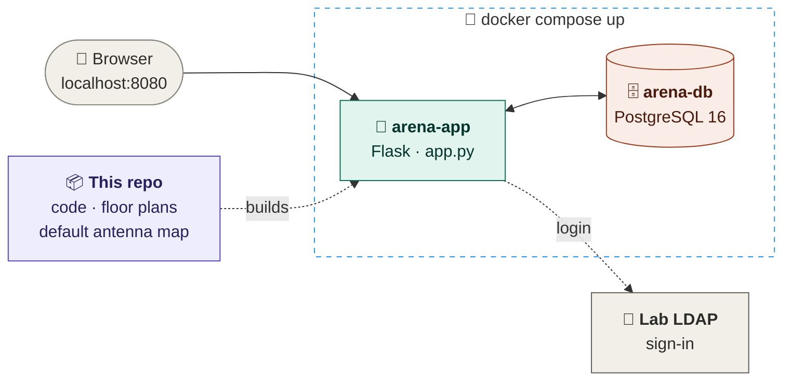
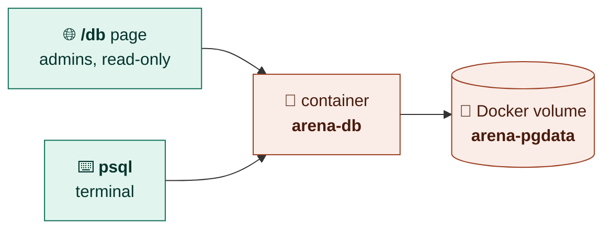
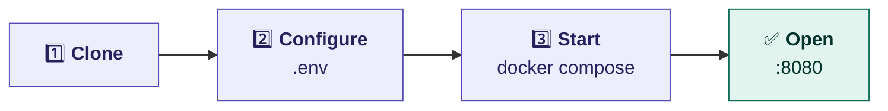

<div align="center">

# 📡 Arena — Patch Antenna Mapper

**Floor-plan map · antenna ↔ USRP wiring · 3D rack view · reservations**


</div>

---

## 🗺️ How it fits together



## 📦 What lives where

| | 📁 Repo (code) | 🗄️ Database |
|---|:---:|:---:|
| 🏢 Floor plans — 6th & 7th floor | ✅ | |
| 📍 Default positions — 68 antennas (AR1 · AR2) | ✅ | |
| 🗄️ Rack layout + lab equipment | ✅ | |
| ✋ Antennas moved on the map | | ✅ |
| 🔌 Antenna ↔ USRP IP / port mappings | | ✅ |
| 📱 Radio / phone markers | | ✅ |
| 📅 Reservations · 🧪 test history · 👥 roles | | ✅ |

> [!TIP]
> A fresh start has an **empty database** — the map shows every antenna at its
> default spot. Everything in the 🗄️ column fills in as people use the site.

## 🗄️ Where's the database?



| Want to… | Do |
|---|---|
| 👀 Browse every table | open `/db` in the site (admin) |
| ⌨️ Query it directly | `docker compose exec db psql -U arena arena` |
| 💾 Back it up | `docker compose exec db pg_dump -U arena arena > backup.sql` |
| 🧹 Wipe it (start empty) | `docker compose down -v && docker compose up -d` |

## 🚀 Replicate it



```bash
git clone git@github.com:wineslab/arena-website.git && cd arena-website
cp .env.example .env              # SECRET_KEY + LDAP_* values
docker compose up -d --build      # → http://localhost:8080
```

> [!NOTE]
> 🔐 Sign-in goes through the lab LDAP server — run it on the lab network.
> Put your username in `ARENA_BOOTSTRAP_ADMINS` to be admin on first start.

| Need to… | Run |
|---|---|
| 🔁 Use another port | `ARENA_PORT=9090 docker compose up -d` |
| 🐘 Port 5432 already taken | `ARENA_DB_PORT=55432 docker compose up -d` |
| 📜 Follow app logs | `docker compose logs -f app` |
| ⏹️ Stop (data kept) | `docker compose down` |

---

## 🔗 Pages

| URL | What it is | Role |
|---|---|:---:|
| `/` | 🗺️ Map view + rack view toggle | viewer |
| `/admin` | 👥 Permissions — roles for users / groups | admin |
| `/db` | 🗄️ Read-only database viewer | admin |
| `/api/health` | 💓 App + DB health check | public |

---

## Authentication & access control (LDAP + RBAC)

Every page and API now requires sign-in. Users authenticate against the
testbed LDAP server; their **role** is derived from LDAP group membership.

**Roles** (most → least privileged): `admin` > `editor` > `viewer`.

| Role | Can do |
|---|---|
| `viewer` | Read everything: view the map, list mappings/devices, exports |
| `editor` | Everything a viewer can, **plus** edit mappings/devices/positions and run USRP tests |
| `admin` | Everything, **plus** the `/db` database viewer and the `/admin` permissions panel |

`/api/health` stays public (uptime checks). Static assets stay public.

### Managing permissions in-app (`/admin`)

Admins get a **Permissions** panel (`/admin`, also linked from the map nav)
where they assign `viewer`/`editor`/`admin` to individual **users** or to LDAP
**groups** — no env-var editing or redeploy needed. These DB-managed grants are
resolved with this precedence:

```
DB user grant  →  DB group grant (highest role)  →  LDAP ARENA_ROLE_MAP  →  ARENA_DEFAULT_ROLE
```

So the in-app grants take priority, and anyone without a grant still falls back
to the existing LDAP group mapping. A direct user grant always beats a group
grant. User-level changes take effect on the user's **next request**; group and
LDAP changes apply at their **next login**.

**Bootstrap admin.** On first startup the username(s) in `ARENA_BOOTSTRAP_ADMINS`
are seeded as `admin` — *only if they have no
grant yet* — so the first admin can sign in and grant everyone else. These are
ordinary admin grants, not a separate tier; change or remove them from `/admin`
once others are set up. (You can't strip your own admin from the panel, to avoid
locking yourself out.)

### How auth works

1. **Login** (`/login`) — the app binds to LDAP **as the user** (direct bind:
   `uid=<username>,ou=Users,dc=sc2,dc=net`). A successful bind = valid password.
2. **Role** — it then searches the group tree for groups the user belongs to
   (`uniqueMember=<user-dn>`) and maps group `cn` → role via `ARENA_ROLE_MAP`.
3. The role is stored in a signed session cookie (`SECRET_KEY`); no local user
   table. Sign out at `/logout`.

> This directory **refuses anonymous search**, so the app uses *direct bind* by
> default (`LDAP_AUTH_MODE=direct`) — no service account required. Set
> `LDAP_AUTH_MODE=search` (with `LDAP_BIND_DN`/`LDAP_BIND_PASSWORD`) if your
> users don't live directly under one OU.

### Configuration

All settings are env vars (see `.env.example`). The key one to **edit for your
directory** is the group→role map — change the group names to match yours:

```bash
ARENA_ROLE_MAP={"admin":["arena-admins"],"editor":["arena-users"]}
ARENA_DEFAULT_ROLE=viewer   # role for authed users in no mapped group ('' = deny)
```

Also set a stable `SECRET_KEY` (generate: `python3 -c "import secrets; print(secrets.token_hex(32))"`).

> **TLS note:** `LDAP_TLS_VALIDATE=false` by default (the server uses a
> self-signed cert). Turn it on in production once a trusted cert is in place.

---

## What you're looking at (UI tour)

The frontend is a single page with two main views, switched by the
**"Rack view"** button at the top-right.

### Map view (default — `/`)
- Floor plan SVG with antenna dots overlaid.
- **Top-left card:** brand + 6th / 7th floor selector.
- **Top-right pills:** Rack view toggle · JSON export · CSV export · DB viewer.
- **Bottom-left card:** Layers panel — toggle USRP / radio / UE dots, filter
  by mapped / unmapped.
- **Phone marker:** draggable phone icon (one per floor).
- **Right rail:** edit panel for the currently selected antenna / device.

### Rack view (toggle from map)
- Two tabs / grids: **AR1** and **AR2**.
- Two sections per arena: the antenna grid, and the **USRP rack** (cards for
  each USRP IP).
- Clicking a USRP card opens the test panel on the right — **this is where
  the USRP test button lives**. ⚠️ The test runner is currently a stub
  (see "USRP test runner" below).

### Database viewer (`/db`)
Plain HTML tables of every model — useful when you want to see exactly what's
in the DB without firing up `psql`.

---

## Where do I look for X? (file map)

| If you want to change… | Look here |
|---|---|
| **Page structure / layout / buttons** | `templates/index.html` |
| **Database viewer page** | `templates/db.html` |
| **All styles (colors, spacing, components)** | `static/css/main.css` |
| **Antenna grid, rack view, USRP cards, test panel, map interactions** | `static/js/app.js` |
| **Draggable phone marker** | `static/js/phone.js` |
| **Device add/edit/delete logic** | `static/js/devices.js` |
| **Hardcoded USRP IP rack order** | `static/js/app.js:294-304` (`RACK_ORDER_AR1`, `RACK_ORDER_AR2`) |
| **Hardcoded antenna IDs / coordinates** | `static/js/app.js:10` (`ANTENNA_COORDS`, `LAYOUT_AR1/AR2`) |
| **USRP models / port labels dropdowns** | `static/js/app.js:119` (`USRP_PORTS`, `USRP_MODELS`) |
| **REST endpoints for mappings, devices, phones, export** | `routes/api.py` |
| **Permissions panel (page + grant CRUD API)** | `routes/admin.py`, `templates/admin.html` |
| **Who-gets-what role resolution / LDAP login** | `routes/auth.py` |
| **Page routes (`/`, `/floorplan`, `/db`)** | `routes/views.py` |
| **USRP test runner endpoints** | `routes/tests.py` |
| **DB schema (tables + helper functions)** | `models.py` |
| **Config / env vars** | `config.py` |
| **Flask app factory, migrations** | `app.py` |
| **Floor plan SVG image** | `static/img/floorplan.svg` |

### Symptom → file shortcuts

- "I want to add a new USRP IP to the rack view" → `static/js/app.js:294` (`RACK_ORDER_AR2`).
- "I want to change what columns show in `/db`" → `templates/db.html`.
- "I want to change colors / fonts" → `static/css/main.css` (design tokens at top).
- "The test button doesn't actually run anything" → that's expected, see below.
- "I want to add a new floor" → search for `floor=6` / `floor=7` across `routes/`, `models.py`, `static/js/app.js`.

---

## 🧱 Repo map

```
arena-website/
├── 🐳 docker-compose.yml      arena-db (Postgres) + arena-app (Flask)
├── 🐳 Dockerfile              arena-app image
├── 🧩 app.py                  app factory · startup migrations
├── ⚙️  config.py               env-driven config (DB, LDAP, roles)
├── 🗄️  models.py               SQLAlchemy models + helpers
├── routes/
│   ├── api.py                 /api/*  mappings · devices · positions · export
│   ├── views.py               /  /floorplan  /db
│   ├── auth.py                /login  LDAP + roles
│   ├── admin.py               /admin  permissions
│   ├── reservations.py        /api/reservations/*
│   └── tests.py               /api/test/*  (runner stubbed)
├── templates/                 index · login · admin · db · 403
└── static/
    ├── img/                   🏢 floorplan.svg (6th) · floorplan-7.svg (7th)
    ├── js/app.js              📍 ANTENNA_COORDS — default antenna map
    ├── js/rack3d*.js          🗄️ 3D rack view + lab equipment list
    ├── js/                    devices · phone · reserve · intro
    └── css/main.css
```

---

## USRP test runner (current state)

The website used to spawn `internal_loop.py` from the `USRP_unittest` repo as
a subprocess. **That integration has been disconnected.** The UI, API, and DB
are intact; the runner function is a stub.

- **Stub location:** `routes/tests.py::_run_test` (≈ line 68).
- **What happens now:** clicking a USRP test button flips the card to
  "running" briefly, the log shows four `[stub]` lines, then the job lands in
  `error` with the message *"USRP test runner not configured — integration
  with USRP_unittest has been removed."*
- **To plug a new runner in:** replace the stub body in `_run_test`. The
  expected contract is documented in the function's docstring. Output should
  land under `USRP_OUTPUT_PATH` (defaults to `./output/runs/<ip>_<timestamp>/`).
- The frontend test panel (polling, log rendering, plot display) is in
  `static/js/app.js:471-573` — no changes needed there as long as the new
  runner streams text into the log buffer and optionally writes `result.json`.

---

## API endpoints

### App data (`routes/api.py`)
| Method | Path | Purpose |
|---|---|---|
| GET | `/api/mappings` | All antenna→USRP mappings |
| POST | `/api/mappings` | Replace all mappings |
| GET | `/api/phones[/<floor>]` | Phone marker for a floor (default 6) |
| POST | `/api/phones[/<floor>]` | Update phone marker |
| GET | `/api/devices` | List devices |
| POST | `/api/devices` | Create device |
| PUT | `/api/devices/<id>` | Update device |
| DELETE | `/api/devices/<id>` | Remove device |
| GET | `/api/antenna_positions` | Custom antenna dot positions |
| PUT | `/api/antenna_positions/<id>` | Override an antenna position |
| DELETE | `/api/antenna_positions/<id>` | Reset to default |
| GET | `/api/export/json` | Download config as JSON |
| GET | `/api/export/csv` | Download config as CSV |
| GET | `/api/health` | DB connectivity check |

### USRP test (`routes/tests.py`)
| Method | Path | Purpose |
|---|---|---|
| POST | `/api/test/usrp` | Start test for `{ip, opensearch?}` → `{job_id}` |
| GET | `/api/test/usrp/<job_id>` | Status + live log + plots list |
| GET | `/api/test/usrp/history` | Latest test per IP (map) |
| GET | `/api/test/usrp/history?ip=...` | Last 20 runs for an IP |
| GET | `/api/test/usrp/<job_id>/plot/<name>.png` | Serve a plot file |

---

## Database schema

Open a session:

```bash
docker compose exec db psql -U arena arena
```

| Table | Model | Purpose |
|---|---|---|
| `antenna_mappings` | `AntennaMapping` | Antenna → USRP wiring (port 1 + port 2) |
| `phone_positions` | `PhonePosition` | One draggable phone marker per floor |
| `devices` | `Device` | Generic devices placed on the floor plan |
| `antenna_positions` | `AntennaPosition` | Per-antenna overrides for default coords |
| `test_results` | `TestResult` | USRP test history (log, result_json, status) |

### `antenna_mappings`
| Column | Type | Notes |
|---|---|---|
| `antenna_id` | text PK | e.g. `AR2_A1` |
| `p1_serial` | text | USRP IP on port 1 |
| `p1_model`, `p1_port` | text | X410 / A:0 / … |
| `p2_serial`, `p2_model`, `p2_port` | text | port 2 wiring |

### `test_results`
| Column | Type | Notes |
|---|---|---|
| `id` | int PK | job id |
| `usrp_ip` | text, indexed | target USRP |
| `test_type` | text | `'internal_loop'` (legacy default) |
| `status` | text | `running` / `success` / `failure` / `error` |
| `started_at`, `finished_at` | timestamp | |
| `output_dir` | text | filesystem path for plots / result.json |
| `result_json` | text | JSON result blob written by the runner |
| `log` | text | captured stdout/stderr |
| `error` | text | failure message |

Schema migrations (added `mapped` to devices, `floor` to phone_positions)
run on startup — see `_migrate_*` in `app.py`.

---

## Configuration

`config.py` reads from env / `.env`:

| Var | Default | Purpose |
|---|---|---|
| `DATABASE_URL` | `postgresql://localhost/arena` | SQLAlchemy connection string |
| `USRP_OUTPUT_PATH` | `<repo>/output/runs` | Where the test runner writes plots and `result.json` per run |
